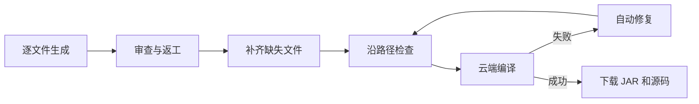

# 生成、检查与编译

确认结构树之后，平台按下面的顺序把结构变成可运行的插件：

## 逐文件生成

文件按依赖顺序生成：先写被依赖的数据和服务类，再写命令和监听器，主类最后生成。多条路径共用的文件只生成一次。每个文件写完后会自动审查，不合格就返工，单个文件最多返工 3 次。

审查中发现缺了某个类时，平台会自动补上，并把它加到结构树里。

## 沿路径检查

文件齐全后，模型沿每条行为路径读一遍实际代码，逐步确认：命令和监听是否注册、触发条件是否正确、数据是否真正保存和读取、结果是否送达玩家。每一步都会记录证据或问题。

检查没通过时，平台会根据问题修改相关文件一轮，再重新检查全部路径。

## 云端编译与自动修复

代码会上传到 GitHub Actions，用 Maven 真实编译。编译失败时，平台读取报错，判断是代码写错还是用到了当前版本没有的 API，必要时先联网查证官方资料，再修改代码重新编译，最多自动修复 3 次。

## 进度和中断

- 生成页的状态卡会实时显示当前在做什么，例如“正在查证资料”“正在编译”。
- 默认逐个阶段推进，每完成一个阶段就保存一次。开启「超级并发」后会同时推进多个文件，速度更快。
- 刷新、断网或按 Esc 撤回后，任务停在中断状态，**不会自动继续消耗 token**。回来后点击「继续任务」，从已保存的阶段接着做。

## 下载

- **下载 JAR**：云端编译出的插件。第一次下载后会缓存在浏览器里，之后服务端任务过期也能再次下载。
- **下载源码 ZIP**：完整 Maven 工程和 `PROJECT_TREE.md`。只要文件齐全，即使编译失败也可以下载。
- **下载安全 Debug**：一份去掉源码、提示词和密钥的诊断记录，方便排查问题。

<a class="detail-link" href="/technical/generation-pipeline">了解细节：生成流水线 →</a>
<a class="detail-link" href="/technical/compile-learning">了解细节：编译诊断与 API 学习 →</a>
