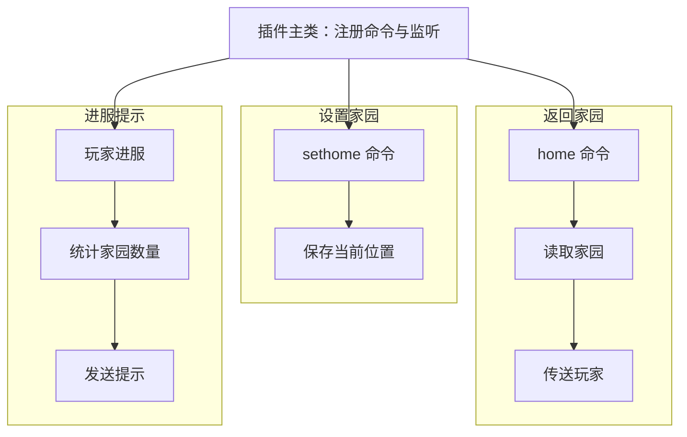

# 生成示例：家园插件

以家园插件为例，在对话框里用 Markdown 列表写下需求：

```
Paper 1.21.4 家园插件
- `/sethome` 设置家园，`/home` 返回家园
- 数据用 YAML 保存
- 玩家进服时提示自己有几个家园
```

## 1. 确认需求

核心、版本和数据格式都已经写在描述里，平台不会再弹出版本选择，只用一两张确认卡片询问剩下的细节，例如每人最多几个家园。

## 2. 检查结构树

模型给出三条并列的行为路径，每一步绑定要写的文件：



“保存当前位置”和“读取家园”绑定同一个家园数据文件，这个文件只生成一次，三条路径共用。

点击任意节点可以查看它负责什么、绑定哪个文件。想加功能时，在底部输入“返回家园增加 5 秒冷却”，模型会同时调整路径、文件和接口约定。

## 3. 生成与检查

确认结构后，文件按依赖顺序生成，节点上会显示每个文件的状态。全部文件写完后，模型沿每条路径检查实现：命令是否注册、条件判断是否完整、数据是否真正保存和读取。

## 4. 编译

平台在 GitHub Actions 上真实编译。某条路径的静态检查和编译都通过后，连线会播放一段方块粒子动画并从虚线变成实线。

如果静态检查发现问题，结论会保留在路径上，编译通过也不会抹掉它。

## 5. 下载与实测

下载 JAR 放进服务器，再下载源码 ZIP 备查。`PROJECT_TREE.md` 列出了每条路径、绑定的文件和检查结论。最后在自己的服务器里进游戏实测。

## 中途断开怎么办

刷新或断网后，任务会停在中断状态，不会自动继续消耗 token。从历史记录恢复工程，点击「继续任务」即可。即使编译失败，只要文件齐全，也可以先下载源码查看。

[快速开始](/guide/quick-start) · [结构树与行为路径](/features/structure-tree)

<a class="detail-link" href="/technical/generation-pipeline">了解细节：生成流水线 →</a>
