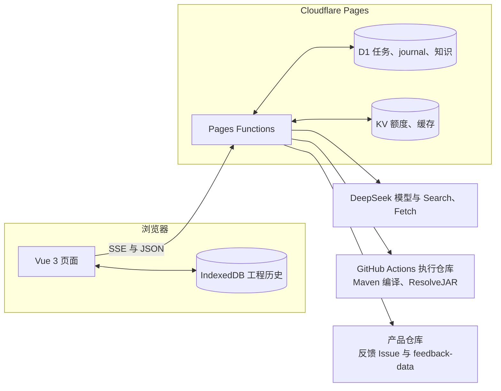

# 系统架构

应用由 Vue 3 前端、Cloudflare Pages Functions、D1/KV、DeepSeek 模型服务和独立的 GitHub Actions 执行仓库组成。Pages 负责编排请求与状态，Java 编译和 JAR 反编译在执行仓库进行，游戏内实测交给用户。

## 前端

技术栈为 Vue 3（`<script setup>`）、TypeScript、Vite 和 Vue Router，生产依赖只有 `vue`、`vue-router`、`jszip` 和 `lucide-vue-next`。状态使用模块级 `reactive`／`ref`，不引入 Vuex 或 Pinia；顶栏中部文案等跨层级状态通过 `provide`／`inject` 传递。

根路径 `/` 默认跳转到 `/chat`，`/home` 为独立的山谷滚轮视差试验页，以生成的远景、透明山壁和透明岩台三层 WebP 素材构成画面；使用原生滚动、`requestAnimationFrame` 和 CSS `transform`，在视口外预留图像边缘并遵循系统的减少动态效果设置。旧首页介绍卡片已移除，打字机组件归档于 `.deprecated/home-typewriter/`。

| 位置 | 职责 |
| --- | --- |
| `pages/ChatPage.vue` | 需求输入、核心与版本选择、需求确认、历史记录、任务重置 |
| `components/GenerateProgress.vue` | 生成页：结构树、查证记录、流式输出、构建、下载、反馈、中断与错误 |
| `components/ProjectTree*.vue` | Main 长卡与并列的纵向行为路径，节点原位展开详情，路径粒子与边界线灯 |
| `components/TreeGate.vue` | 底部自然语言修正与确认锁定 |
| `components/ToolActivity*.vue` | 由真实工具事件驱动的状态卡与邮票动画 |
| `components/JarImport.vue`、`ProjectFeedback.vue` | JAR 导入弹窗、反馈表单与公开确认 |
| `logic/generateState.ts`、`generateHandler.ts` | 生成状态与快照；分阶段请求、Learning 续接、桶推进、恢复、审查与构建修复 |
| `logic/projectDb.ts`、`projectSession.ts`、`projectArtifacts.ts` | IndexedDB 工程现场、版本与产物缓存 |

界面采用麦色加黑色的窗棂回纹风格：固定文案用江西拙楷，输入、模型输出与代码等动态内容用钉钉进步体，顶栏品牌保留 Minecrafter。只有运行中的内容播放边角动画，并遵循系统的减少动态效果设置。

浏览器快照不保存源码正文；源码通过 `source` 接口按需加载，并写入 IndexedDB 的版本记录。刷新后任务进入中断态，由用户手动继续。

## 服务端

Pages Functions 位于 `functions/api/`，共享逻辑位于 `functions/_lib/`。免费套餐每个请求只有约 10ms CPU，因此所有长流程都拆成“每请求一轮模型调用”，阶段结果落库后由前端发起下一次请求。

| 模块 | 职责 |
| --- | --- |
| `generate/task`、`clarify`、`tree` | 创建任务、需求确认、结构规划与确认锁定 |
| `generate/bucket`、`verify` | 按桶生成、审查、返工、补缺和路径静态审查；按树核对完整性 |
| `generate/build`、`status`、`fix`、`download` | 调度 Actions 编译、读取结果、自动修复、下载产物 |
| `generate/source` | 单文件或完整源码 |
| `generate/checkpoint`、`revise`、`journal` | 工程恢复与重建、追加修改、执行记录 |
| `generate/jar`、`feedback` | ResolveJAR 导入、公开反馈 |
| `learning/*` | 公开 API 查证：开始、推进、状态、证据 |

详细请求与响应见 [API 参考](./api-reference.md)。

## 同一份结构数据

`ProjectTree` 同时保存两种关联：

- `modules`、`nodes`：Java 子包与实现文件。节点含稳定 id、职责、依赖、成员契约、GUI 配对及来源。
- `paths`：行为路径。每条路径包含有序步骤，步骤通过 `fileIds` 绑定一个或多个文件，跨路径复用不产生重复文件。

稳定映射为：步骤 `fileIds` → 文件 `nodeId` → `nodePath` → 文件计划与 `generatedFiles.path` → `nodeChecks` → 前端文件状态。合并与删除文件时同步维护步骤引用。

Main、`plugin.yml` 和 `pom.xml` 属于系统节点。结构锁定时确定性派生项目元信息、Main 装配蓝图和依赖分桶，Main 单独位于最后一个生成桶；锁定后只允许受限的审查补缺追加。

## 验证的含义

- **契约核对**（`projectTreeContract.ts`）：确定性检查包名、类名、公开成员、事件、命令、Main 注册和资源。
- **路径静态审查**（`projectPathReview.ts`）：模型沿每条路径读取关联文件的完整源码，逐步记录证据或问题。
- **编译**：在执行仓库用 Maven 真实编译，结果绑定到相同的代码指纹与 Git 提交。

只有同一版本的路径静态审查与编译均通过，路径才变为实线。修复使旧结论失效；静态失败不会被编译成功覆盖。验证不包含 Minecraft 服务端运行或模拟玩家操作。

## 存储

| 存储 | 内容 |
| --- | --- |
| D1（`DB`） | 生成任务状态、单任务成本、公共技术知识与负面 API 事实、24 小时 journal、反馈与 JAR 提交去重 |
| KV（`TASKS`） | 用户额度、订单、赞助、Skill 缓存、限流兜底 |
| IndexedDB（浏览器） | 工程现场、版本、源码、JAR 产物、草稿和执行事件 |

不使用 R2 或 Durable Objects。

<a class="detail-link" href="./generation-pipeline">下一篇：生成流水线 →</a>
