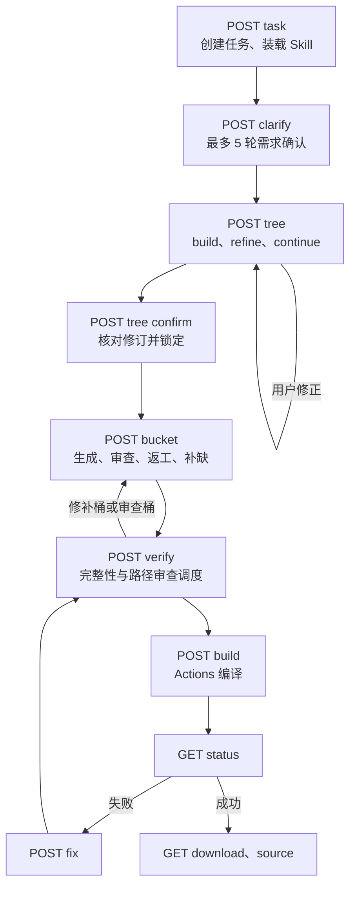

# 生成流水线

生成围绕同一份结构数据推进。每个请求至多进行一轮模型调用，阶段结果落库后由前端发起下一次请求，以适应 Pages Functions 的单请求时限。

## 需求确认

前端预检需求并提取服务端核心与版本，通过 `POST /api/generate/task` 创建任务。Clarifier 最多进行 5 轮，只询问会改变产品行为的关键决策：持久化在 YAML 与 PDC 之间选择；权限前缀、世界范围、外部插件等可选问题默认不问，并写明默认值。

## 结构规划

`POST /api/generate/tree` 的 build、refine、continue 每次只执行一轮模型调用，前端按结果继续、推进 Learning 或等待用户确认。模型必须通过树工具修改结构，不能用正文 JSON 代替：

| 工具 | 用途 |
| --- | --- |
| `set_project` | 项目名、摘要和外部插件依赖（`externalDeps`） |
| `upsert_module` | Java 子包与业务职责 |
| `upsert_node` | 单个实现文件、依赖和 Node contract |
| `upsert_path` | 编排行为路径与步骤，绑定已有文件 |
| `remove_path` | 删除行为路径 |
| `remove_items` | 删除文件或模块并清理引用 |
| `merge_nodes` | 合并文件，重写依赖、配对和步骤绑定 |
| `finish_tree` | 提交结构完整性校验 |

规划约定：

- 插件实例与服务通过**构造器注入**传递，插件参数类型为 `Plugin`，由 Main 传入 `this`；`depends` 只填服务，不填 Main。被调用的方法写入 `contract.methods`。
- 命令、调度和外部插件依赖分别写入 `contract.commands`、`contract.schedule` 与 `set_project.externalDeps`；持久化、调度等约束和 `config.yml` 按需适用。
- 连续两轮没有有效结构变更时停止推进，并保留每轮的完整性问题与工具失败原因。

确认时核对修订号并锁定结构，按依赖拓扑派生文件计划、分桶和 Main 装配蓝图。确认不调用模型；相同修订重复确认直接重放。

## 生成、审查与返工

Generator 按文件类型工作（命令、监听、服务、数据、配置、GUI、Main、`plugin.yml`、`pom.xml` 等），输入包含已确认需求、路径步骤、文件职责、依赖契约、Skill 与可用的公共技术知识。

- 每个文件按“生成 → 审查 → 返工”的持久化阶段推进。返工与首次生成由 `dispatchGen` 统一组装，带入相同的类型专项规则、Skill 骨架和节点上下文。
- 生成、审查和返工共用目标版本断言：不得因模型记忆中没有该版本而更换核心、降低 MC／Java／依赖版本或删减功能。
- 事件优先级默认不填；只在事件未被取消时执行的结果逻辑使用 `MONITOR` 与 `ignoreCancelled = true`，异步事件回到主线程后再操作世界、实体或背包。
- 确定性契约检查先于模型审查；单文件最多返工 3 次，动态补缺每个目标最多 3 个类。达到上限的版本不会被标为审查通过。
- 审查追加的文件使用稳定 nodeId，通过 `tree_patch` 事件更新页面并补入计划。

## 路径静态审查

文件齐全后，`verify` 为当前代码指纹安排路径审查桶，`bucket` 每次只审查一条路径。模型沿步骤读取关联文件的完整实现，检查入口注册、触发条件、调用参数与返回值、条件分支、共享状态、资源、调度、生命周期清理及结果，逐步保存证据或问题。

审查未通过时，失败步骤绑定的文件和契约不满足的文件以审查结论为原因返工一轮（上限 1 次），完成后重新审查全部路径。修正桶中业务文件未完成时暂不处理 Main。修正未完成时，构建返回 `PATH_REVIEW_REQUIRED`。

## 编译与修复

`build` 只构建服务端已保存的文件，通过 Git Tree API 一次提交到执行仓库的临时分支并调度工作流；`status` 只在真实工作流成功并取得产物后确认编译结果，并把结果绑定到相同代码指纹。

编译失败后，`fix` 读取诊断，判断是普通实现错误还是明确的外部 API 缺口，必要时经 Learning 查证后修复；前端最多自动修复 3 次。修复改变代码后，旧的路径结论失效，重新构建前再次审查。详见[编译诊断与 API 学习](./compile-learning.md)。

## 工具活动与恢复

Skill 装载、树工具、Learning、路径审查、编译启动和状态刷新使用真实的开始与结果事件驱动状态卡动画；编译启动确认不等于编译通过。

树规划使用请求 ID、输入哈希、执行租约与原子计费，完成的请求可以重放。刷新后任务进入中断态，由用户手动继续；页面从服务端恢复树、检查结论、文件状态和桶位置。服务端任务过期后的恢复见[工程生命周期](./project-lifecycle.md)。

## 模型档位

两档都调用 `deepseek-flash`：需求确认、结构规划、路径审查、审查器、返工、修复与证据验证使用 `reasoning_effort: "high"`；文件生成、预检、摘要与动态补缺使用 `low`。Prompt 的位置与行号见仓库 `ref/deepseek-prompts.md`。

<a class="detail-link" href="./api-reference">下一篇：API 参考 →</a>
